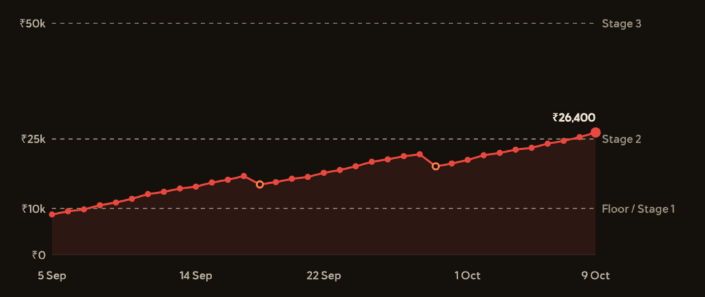

# Emergency fund dashboard

A set of Obsidian notes that track a personal emergency fund. The notes show the status of the fund in one dashboard.

## What it does

An emergency fund is money that you keep for sudden costs. Most people have no rule for when to use it, or how to refill it.

This project gives the fund rules, like the risk limits of a trader. You write one number each day: the total in the fund. The dashboard reads that number and shows:

- the most that you can take out now,
- the amount that you owe the fund after a withdrawal,
- the state of the fund: Green, Yellow, Orange, or Red,
- the days left to the next target, at your current pace,
- an alarm when the fund falls too far from its highest level,
- a graph of the balance by date, with the floor and the targets as dashed lines.



The picture is the graph in Obsidian. It is drawn from a sample Log of 35 days. This Log is not the sample in `notes/`. The colors come from the Obsidian theme of the author. Your colors can differ.

The dashboard is code inside one note. The daily log is a table in a second note. It runs in Obsidian with the Dataview plugin. It needs no server and no account. All data stays in your vault.

The formulas are in [docs/formulas.md](docs/formulas.md). The page explains each number with a plain definition and an example.

## Requirements

- Obsidian. Version 1.13.7 was tested.
- The Dataview plugin, with JavaScript queries on. Version 0.5.68 was tested.
- Linux was the only operating system tested. The mobile app was not tested.

The project has no other dependency. Node.js and Python are not needed.

## Install

1. Install the Dataview plugin and turn on `Enable JavaScript Queries` in its settings.
2. Clone the repo:

   ```
   git clone https://github.com/Orpheus-21/emergency-fund-dashboard.git
   ```

3. Copy all nine files from the `notes/` folder into your vault.
4. Open the note `Emergency fund(log)`.
5. Delete the five sample rows in the Log table. Write your first row.
6. Open the note `Emergency fund dashboard` in Reading view. The graph shows above the Status table.

[docs/obsidian-setup.md](docs/obsidian-setup.md) has the full steps, the names that you must keep, and a list of problems with fixes.

## Usage

### Log a day

Add one row each day at the bottom of the Log table in `Emergency fund(log)`. Write the date as `YYYY-MM-DD`. Write the total cash in the fund. The note column is optional.

```
| Date       | Total (₹) | Note       |
| ---------- | --------- | ---------- |
| 2026-10-06 | 9,000     |            |
| 2026-10-07 | 8,700     | bus ticket |
```

A total that falls is a withdrawal. A total that rises is a deposit. You do not log them in separate columns.

### Take cash out

1. Open `Emergency fund checklist`.
2. Apply `Emergency fund test`. If one answer is no, stop.
3. Read `Max withdrawal now` in the Status table of `Emergency fund dashboard`.
4. Take the cash. Log the new total the same day.
5. Read `Replenishment owed`. Pay this amount back before you spend spare money on other things.

### Read the dashboard

Open `Emergency fund dashboard`. The graph shows first. The Status table shows these rows. The values below come from the sample Log in the repo.

```
Balance               ₹19,300 on 2026-10-05
State                 RED (39% of ₹50,000)
Max withdrawal now    ₹3,860
Floor                 ₹10,000 (kept)
Next stage            ₹25,000, ₹5,700 to go
Replenishment owed    ₹1,700 (8% below the peak of ₹21,000)
Drawdown limit        OK (limit 30%)
```

The table has more rows: the log check, the rule for the state, this month, the pace, and the days to the next stage. These rows depend on today's date. The Withdrawals table lists each past withdrawal with a verdict, OK or OVER LIMIT. A colored circle shows before the state name.

## Configuration

The Settings table is in the note `Emergency fund settings`. Change the numbers in the Value column.

| Setting | Default | Meaning |
| --- | --- | --- |
| Floor | 10,000 | The fund must not go below this level for a normal withdrawal. |
| Single-event limit | 20 | The largest share of the balance for one withdrawal, in percent. |
| Drawdown limit | 30 | The alarm level. The alarm starts when the fund is this far below its peak, in percent. |
| Stage 1 | 10,000 | The first target. |
| Stage 2 | 25,000 | The second target. |
| Stage 3 | 50,000 | The long-term target. The state is a share of this number. |
| Green from | 100 | The state is Green from this fill level, in percent of Stage 3. |
| Yellow from | 80 | The state is Yellow from this fill level. |
| Orange from | 60 | The state is Orange from this fill level. Below it the state is Red. |

Two values are in the code and not in the Settings table. To change them, edit the code block in `Emergency fund dashboard`.

- The currency sign and the number format: the line `const money = n => "₹" + Math.round(n).toLocaleString("en-IN");`. Change `"₹"` and `"en-IN"`. This line is in `Emergency fund dashboard` and in `Emergency fund chart`. The chart has a second line, `const short`, with the sign `"₹"` for the axis labels.
- The length of the pace window, 30 days: the number in `Math.min(30, ...)`.

The text of the other notes is yours to edit. The numbers in the dashboard do not depend on that text.

## How it works

The repo has two folders.

| Path | Content |
| --- | --- |
| `notes/` | The nine Obsidian notes. |
| `docs/` | The formulas and the Obsidian setup. |

The code is one `dataviewjs` block in `Emergency fund dashboard.md`. It is about 90 lines of JavaScript. It does these steps:

1. It finds the note `Emergency fund settings` with `dv.page` and reads the file text.
2. It reads each table row in that note. It matches the first column to a setting by the start of the label. It stops with an error message when a value is missing.
3. It finds the note `Emergency fund(log)` in the same way and reads the file text. It keeps the part after the heading `## Log`.
4. It reads each row of that part. A row is valid when the first cell is a date `YYYY-MM-DD` and the second cell is a number. The code skips other rows. When two rows have the same date, the later row wins.
5. It sorts the rows by date and calculates the numbers.
6. It draws two tables with `dv.table`: Status and Withdrawals.

The graph is a second `dataviewjs` block of about 65 lines in `Emergency fund chart.md`. The dashboard note and the log note embed it with `![[Emergency fund chart]]`. The graph reads the same two tables in the same way. It draws an SVG picture with the colors of your Obsidian theme. [docs/formulas.md](docs/formulas.md) lists the rules of the axes.

The code does not write to the vault and does not use the network. No script outside Obsidian is part of the project.

## License

This project uses the GNU General Public License, version 3 or any later version. The file `LICENSE` has the full text.
